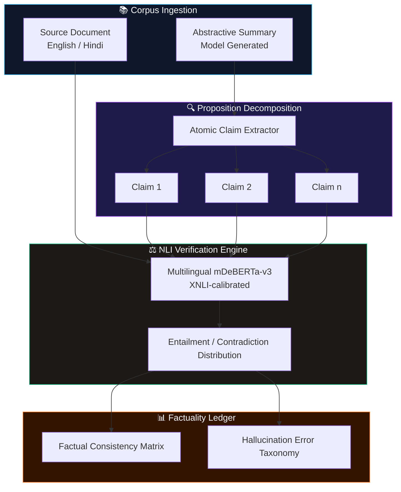

<div align="center">

# 🇮🇳 FactIndic

**Multilingual Factual Consistency & Hallucination Verification for Indic Summarization**

An NLP empirical research framework and verification engine measuring factual consistency and hallucinations in abstractive text summarization across English and Hindi using natural language inference (NLI) and large language model evaluations.

---

[](https://www.python.org/)
[](https://huggingface.co/)
[](https://huggingface.co/MoritzLaurer/mDeBERTa-v3-base-xnli-multilingual-nli-2mil7)
[](https://cohere.com/)
[](https://streamlit.io/)

</div>

<br />

## 🌟 Overview

Abstractive text summarization models frequently hallucinate facts or distort source relationships. While factual verification has been thoroughly benchmarked in high-resource English datasets, Indic languages (such as Hindi) remain vulnerable to semantic drift, gender/morphological inaccuracies, and cross-lingual translation artifacts.

**FactIndic** establishes an empirical, reproducible $2 \times 3$ factorial evaluation protocol across English and Hindi:
- **Controlled Generation:** Strict model parity using Cohere Command A+ with identical decoding hyperparameters.
- **Multilingual NLI Verification:** Zero-shot and fine-tuned cross-lingual natural language inference powered by deterministic `mDeBERTa-v3`.
- **Claim-Level Granularity:** Deconstructs generated summaries into discrete atomic propositions and scores entailment/contradiction against source documents.
- **Epistemic Integrity:** Preserves raw class probabilities ($P(\text{Entailment})$, $P(\text{Neutral})$, $P(\text{Contradiction})$) without synthetic composite weighting.

---

## 🏗️ Verification Pipeline



---

## 🔬 Experimental Factorial Setup

- **Source Invariance:** Identical matched source documents evaluated across both English and Hindi.
- **Generation Model:** Cohere Command A+ (`command-a-plus-05-2026`)
  - Decoding: `temperature=0.3`, `top_p=0.9`, `max_new_tokens=256`.
- **Verification Engine:** `MoritzLaurer/mDeBERTa-v3-base-xnli-multilingual-nli-2mil7` (Commit `b5113eb38ab`).
- **Benchmark Datasets:** XL-Sum English & Hindi (`csebuetnlp/xlsum`).

---

## 💻 Tech Stack

- **Frameworks:** Python 3.11, PyTorch, Transformers, Datasets.
- **LLM APIs:** Cohere Python SDK.
- **Interactive UI:** Streamlit, Pandas, Rich.
- **Testing & Quality:** Pytest, Flake8, Black.

---

## 🚀 Quickstart

### 1. Installation

```bash
git clone https://github.com/Riwitika/FactIndic.git
cd FactIndic

python3 -m venv venv && source venv/bin/activate
pip install -r requirements.txt
```

### 2. Configure Environment

```bash
cp .env.example .env
# Set COHERE_API_KEY in .env
```

### 3. Run Interactive Evaluation Lab

```bash
streamlit run app.py
```

### 4. Execute Batch Evaluation

```bash
python scripts/evaluate.py --dataset xlsum --lang hi --samples 50
```

---

<div align="center">
<sub>Designed & Maintained by <a href="https://github.com/Riwitika">Riwitika</a></sub>
</div>
